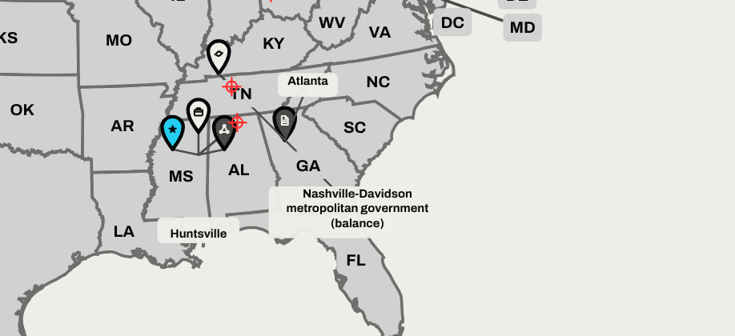

# Map Builder improvement review

Reviewed: November 13, 2026, against versions 3.2.3 through 3.4.0

This review ranks the UI and code improvements that would do the most for Map Builder. It was built from seven independent reviews: code, geolocation and pins, performance, security, tests and CI, user experience, and accessibility. Each reviewer worked on a frozen copy of the app, ran it in a browser, and measured before concluding. Findings marked **measured** were reproduced by running the app or the data. Findings marked **inferred** follow from reading the code and were not reproduced.

Line numbers refer to `geopresence/index.html` at version 3.2.3. Versions 3.3.0 and 3.4.0 changed colors, type and three contrast items, and left the layout engine, data model and import code as they were, so the findings below still apply.

## Shipped since this review

| Version | What it addressed |
|---|---|
| 3.4.0 | Brand Kit type and wordmark; headquarters pins distinct on light maps; placeholder contrast; Remove button outline |
| 3.5.0 | UI items 1 (map-first workspace), 3 (persistent Undo with Ctrl+Z and a reachable history), 4 in part (full screen and zoom above 100%), 6 in part (reset and sample labels), 7 (combobox keyboard), 8, 9, 10 in part (invalid fields marked), 13 in part, and 14 (one corner radius). Table item 8 and table item 10 are done. |
| 4.0.0 | Pin placement: every pin tip is on its point. The 10 samples draw as 9 pins, none off its point (all 10 were off before); Huntsville and Redstone Arsenal, 5 miles apart, share one numbered pin. Fix steps 1, 3 and 4 under "Pins and geolocation" are done with the numbered key. Places within about 21 miles share a pin; state abbreviations and place labels give way. Step 2 is no longer needed because no pin is displaced. |

Dropping a pin, the new pin artwork, the pre-export check, import hardening and the code structure items are still open. The table and figures below describe 3.4.0, before the pin placement change.

## The requirement

> Users should be able to drop real-looking pins in the correct geolocations.

The app does not meet it yet. The data is accurate. The drawing is not.

| Part of the requirement | Where the app stands | Evidence |
|---|---|---|
| Correct geolocations | The stored coordinates are right. The layout engine then moves most pins off them. | Catalog points are within 0.66 miles of Census internal points. With default settings all 10 sample pins are drawn off their points, by a median of 78 miles. |
| Drop a pin | Not possible. A location can only be picked from a catalog through a form. | Clicking the map sets the State field and scrolls away. Dragging a pin does nothing. There is no coordinate or address field. |
| Real-looking pins | The pin reads as a flat outlined sticker. | No shadow, highlight or inner disc; a 2.2 px outline on a 21 x 33 px body; symbols 9 px wide. |

*Version 3.4.0, default settings. Red marks are the true points for Nashville and Huntsville. The Huntsville pins are drawn over Mississippi, the "Huntsville" label sits on the Gulf coast, and the Nashville label prints a Census administrative name in the Florida panhandle.*

## What to build first

Ranked by how much each item moves the app toward the requirement, then by cost. Effort is for one engineer: S is under a day, M is a few days, L is a week or more.

| # | Change | Why it ranks here | Effort | Needs |
|---|---|---|---|---|
| 1 | Add a test that a pin's tip lands on its catalog point | Nothing checks pin position today. Moving every city pin 25 units passed all 54 unit tests and every browser spec. Without this test, items 2 to 6 cannot be trusted. | S | none |
| 2 | Keep every pin tip on its true point; make state abbreviations yield | This is the gap between "correct data" and "correct map". 64% of catalog places cannot hold even a single pin on their own point. | M | 1 |
| 3 | Mark the true point with an anchor dot and merge crowded places into a count pin with a numbered key | Where pins must share a point, the viewer still sees exactly where it is. | M | 2 |
| 4 | Redraw the pin: circular head, sharp tip, contact shadow, larger symbol | Makes the pin read as a pin at export size and fixes the two symbols that do not resolve. | M | best after 2 |
| 5 | Add a runtime map projection and store latitude and longitude on pins | Every form of "drop a pin" depends on it. The app has no projection code and discards latitude and longitude at build time. | M | none |
| 6 | Click the map to place a pin, with snap to the nearest place; coordinate fields; CSV latitude and longitude columns | Delivers "drop a pin". | M | 5 |
| 7 | Tighten project import: allowlist fields, cap size and count, reject unknown installations | A project file can put a fabricated base on the map, freeze the tab on every reload, or fill storage shared with the other apps on the origin. | S | none |
| 8 | Make the map the workspace: map fills the screen, form and list in a side rail | The add form starts 1,131 px down the page, so the map is off screen while locations are added. | M | none |
| 9 | Run the tests on pull requests | Tests currently run only after the merge that deploys. | S | none |
| 10 | Persistent Undo and Redo | Undo exists only in a toast that disappears after eight seconds and cannot be reached by keyboard. | S | none |

## Pins and geolocation

### The data is accurate

All measured.

- The catalog's projection matches an independent Albers USA implementation to 12 decimal places.
- Against Census internal points for 74 places, the median error is 0.04 catalog units and the largest is 0.66 miles.
- Installations checked against Department of Defense boundary centroids: Redstone Arsenal 0.1 miles, Edwards 0.2, Elmendorf-Richardson 4.6.
- An undisplaced pin's tip sits exactly on its point in all three canvas shapes, and within half a pixel in a 2x PNG.
- One-decimal rounding costs at most 0.22 miles (0.62 in the Alaska inset).

Two limits of the data itself:

- Anchors are Census polygon internal points, not downtowns. Against the centers of 987 large cities the median gap is 1.3 miles and the largest is 33.6. San Francisco's point is in the Pacific, about 30 miles west of Sausalito.
- Between 131 and 143 places (two independent checks) and 41 installations fall outside their own state's shape. Utah Test and Training Range is filed under Nevada and drawn in Utah.

### The drawing is not

All measured, default settings, 16:9 canvas. One catalog unit is 3.05 miles; one export pixel is 2.8 miles.

| Map | Pins off their point | Median distance | Largest |
|---|---|---|---|
| The 10 built-in samples | 10 of 10 | 78 miles | 149 miles |
| The 44 largest cities, one pin each | 32 of 44 | 98 miles | 258 miles |
| Samples plus 14 pins in Arlington, Alexandria, Washington and Huntsville | 23 of 23 | 235 miles | 457 miles |
| Any single pin on an empty map | 20,378 of 32,058 places (64%) | 78 miles | not measured |

In the dense case Huntsville's pins sit over Arkansas and Washington's over Lake Erie. Three sample pins land in the wrong state (Dayton is drawn in Indiana).

**Cause.** In `mapMarkup` (lines 267 to 280) each pin reserves a 36-unit box, about 110 miles across, that must clear state abbreviations, other pins and the map edge. The state abbreviation keeps its position and the pin moves. With "State labels" switched off, 8 of the 10 samples and 30 of the 44 cities land exactly.

**Why a viewer cannot recover the true point.** Nothing marks it. Leader lines match state borders in weight and color, state labels paint over the ends of leaders, and place labels drift to other pins. The only warning is "5 place labels use a fallback position", and export proceeds.

**Fix.**

1. Treat the tip as fixed. Remove state-label boxes from the pin collision test. The abbreviation moves, hides, or is drawn underneath.
2. Draw an anchor dot at the true point, above state labels. Leaders end in it and take a style that cannot be mistaken for a border.
3. Displace a pin only when it collides with another pin. Where places are closer than one pin width, merge them into one count pin on the true point and list the breakdown in a numbered key beside the legend. A magnified metro inset in the ocean margin is the heavier alternative.
4. Keep place labels within one pin height of their pin, or move them to the key.
5. Check before export and name any pin that is still off its point.

At this scale, pins within about 125 miles of each other cannot both sit on their points (inferred), so step 3 is required, not optional. Street-level placement is not representable: the White House and the Capitol are half a pixel apart.

### Dropping a pin

What each interaction needs in an app with no backend:

| Interaction | What it needs | Effort |
|---|---|---|
| Any of the below | Forward and inverse Albers USA at runtime, about 40 lines with no dependencies. The same code exists in `scripts/generate-geopresence-place-catalog.mjs` (line 327); move it to a module that the generator and the app both import. | S |
| Latitude and longitude fields; CSV columns | A new "point" anchor that stores latitude and longitude and derives x and y at load. Today `sanitizePin` silently drops a pin that has only latitude and longitude, and the CSV importer ignores those columns without an error. | S |
| Click or tap to place | Screen position to map units through the map group's inverse transform, then the inverse projection. Alaska and Hawaii are told apart by two boxes (no lower-48 place falls in either). State from a point-in-shape test. A brute-force nearest-place lookup takes 1.4 ms (measured), so snapping needs no index. | M |
| Drag to adjust | Pointer capture on the anchor. Only meaningful once pins stay on their points. | M |
| Paste an address | Not possible offline (inferred). Offline options: parse pasted coordinates and map links, or ship a ZIP-centroid table. An online geocoder would break the rule that the app contacts no outside service. | L |

Target behavior: the map is the workspace. A ghost pin follows the pointer, snaps to the nearest city or installation within 25 miles and names it. Click places it; a small popover asks for the type (last used) and an optional label. Dragging re-snaps; holding Alt places freely. One search box accepts "Huntsville, AL", an installation name, or "34.73, -86.59". On touch, tap places and long-press drags with a magnifier above the finger. The list and the map select each other.

A free-coordinate path already exists by accident and should be closed or made official: a project pin with `anchorKind: "installation"`, an unknown `anchorId` and raw x and y survives import and renders. It accepts x = 5000 (off the canvas), and editing it throws a TypeError in `startPinEdit`.

### Real-looking pins

Current pin, measured: body 21 x 33 px at 16:9, ratio 1 to 1.55, convex sides, a 63 degree tip, outline 2.2 px (10% of the width on each side). The count badge is 17 px, larger than the symbol. The Customer symbol renders as a dot and a wedge, and the Partner symbol does not resolve at 1x. Legend pins are a quarter smaller than map pins.

Proposed pin, prototyped. R is the head radius (10.5 units), the tip is the origin, y is negative upward.

| Part | Specification |
|---|---|
| Body | `M0 0C-.16-.52-.56-1.42-.913-2.042A1 1 0 1 1 .913-2.042C.56-1.42 .16-.52 0 0Z`, scaled by R. Circular head centered at (0, -2.45R), height 3.45R, 48 degree tip. |
| Ground shadow | Ellipse at the true point: cx .12R, rx .62R, ry .2R. Black radial gradient, .38 to .14 at 60% to 0. |
| Fill | The pin color, plus a diagonal overlay on the same path: white .24 fading to 0 at 45%, then black 0 at 55% rising to .26. |
| Highlight | Ellipse at (-.36R, -2.86R), rx .3R, ry .16R, rotated -35 degrees, white .4. |
| Rim | 1.2 px, black at .35 on light land, white at .85 on dark. |
| Inner disc | Radius .64R, with the symbol at half-size .44R. Symbols redrawn as filled shapes; Customer and Partner redrawn. |
| Anchor dot | Radius .13R at the true point, above state labels. |
| Count badge | Radius .52R at the head center plus (.78R, -.78R). |
| Export safety | Two shared gradient definitions, no filters, no `<use>`. For tools that drop gradients: three stacked shadow ellipses (.10, .12, .16) and a black .16 crescent. |

The gradients are opacities laid over the fill, so the pin keeps the brand colors and the three pin forms introduced in 3.3.0. The legend should present those forms as three captioned groups (Astrion headquarters; Astrion sites; presence at a customer, partner or planned site) with pins at map size.

### Catalog fixes

- Add a point-in-state check to the catalog build with an overrides file. Correct San Francisco and Utah Test and Training Range first. (S)
- Add downtown overrides for the cities whose internal point is far from the center. (S)
- The installation catalog has no generator; `scripts/split-geopresence-catalogs.mjs` was a one-time script. Write a real generator that keeps latitude and longitude. (M)
- Two copies of the place-name logic disagree (`placeBaseName`, line 115, and the generator's `basePlaceName`). Nine places print wrong labels on exported maps, including "Indianapolis city (balance)", "Nashville-Davidson metropolitan government (balance)", and "Carson" for Carson City. Have the generator emit the display name. (S)

## UI improvements

Ranked by effect on someone building a map. All measured on version 3.3.0 unless marked.

1. **The map is off screen while locations are added.** The form starts at y = 1,131 on a 1440 x 900 screen (34% of the map visible; none at 1024 or 390 wide). A first pin takes five pointer actions, two typed entries and a scroll back. Remove the hero, quick links and reference note (190 px), let the map fill the viewport, and put Locations and Design in a 320 px side rail. Under 860 px, pin the map at 45% of the height above a bottom sheet. (M)
2. **The form fights repetition.** "Location name" is required but never appears on the map or in the default SVG. State, type and source reset to Alabama, Site and City after every add. Typing "Colorado Springs" with Alabama selected returns "No matching places". Nine locations at four places took about 60 clicks. Use one search across both catalogs, make the name optional with a "show as label" switch, keep the last state and type, and offer "Add another here". (M)
3. **Undo lasts eight seconds.** It exists only in a toast, with no button, shortcut or redo. It is last in the page order (26 Tab presses away after removing one of ten locations), hides while focused, and then drops focus to the page body. Undoing an add also reverts a later theme or title change. Error toasts vanish in 3.2 seconds. Add persistent Undo and Redo buttons with Ctrl+Z and Ctrl+Shift+Z, pause the toast timer on hover and focus, and keep errors until dismissed. (S to M)
4. **Zoom and full screen under-deliver.** Zoom stops at 130% (a 720 px height cap) and further clicks only add blank scroll. Dragging selects page text. "Full-screen" opens a 1100 x 765 dialog, and on a phone a 319 x 179 one, smaller than the inline preview. Provide real full screen, wheel and pinch zoom to the cursor, and drag to pan. (M)
5. **The location list does not scale.** Nineteen rows are 1,468 px tall (2,685 on a phone) with 34 px buttons. Rows are inert. "Replace with sample locations" sits beside the save button and offers to replace an empty project. Group by place, add a filter, make a row select and pan to its pin, raise targets to 44 px, and show samples only in the empty state. (M)
6. **Settings and export are scattered.** Opening Map details closes Quick setup. PNG quality sits under Advanced. "Reset" in the settings header also deletes every location. Let sections open independently, add an Export menu that shows the pixel size, and rename the button "Reset everything". (S)
7. **The location combobox misbehaves with the keyboard.** Any key, Tab included, reopens the list, so it stays open and covers the Location type field after focus leaves. The list is a Tab stop, has no name, and "required" is conveyed only by an asterisk hidden from assistive technology. Ignore Tab and modifier keys, close on focus-out, name the list, and set `aria-required`. (S)
8. **"Open project" shows no keyboard focus.** Focus lands on a hidden 1 px file input. One CSS rule on the label fixes it. (S)
9. **Focus is lost** after Download PNG and Copy PNG (the focused button is disabled during export) and after removing the last location. Use `aria-disabled` or restore focus afterward. (S)
10. **Errors are weakly distinct by sight.** The wiring is correct (`aria-invalid`, described-by, focus to the first invalid field). Visually an error is bold 12 px text under the help text and the field border is unchanged; error toasts look like success toasts. Give invalid fields a 2 px Bone border, prefix messages with an icon and "Error:", and mark error toasts as alerts. (S)
11. **Transparent exports lose contrast.** Leader lines take the color chosen for the destination but cross land (1.4 to 2.0 to 1). Legend pins sit on the destination, so on a dark slide a headquarters pin reads as outlined and outlined pins read as solid. "Auto" text switches to light below a luminance of .35 when the true crossover is near .17. Color leaders from the theme, put a land-colored plate behind the legend, and pick the text tone with the higher ratio. (M)
12. **Exported SVGs are unnamed by default.** "Clean SVG metadata" removes the title and description but leaves the attributes that point to them. Always keep the root title and description. (S)
13. **Smaller items.** The selected combobox option is invisible in Windows high-contrast mode. The confirm dialog opens on "Continue" and does not announce its question. The reduced-motion rule misses the disclosure arrow. The first toast may go unannounced because its region is hidden until then (inferred). (S each)
14. **Brand finish.** Colors, type and the wordmark now follow the Brand Kit. Corner radii (eight different values) and the card layout still follow the earlier look; the website uses 4 px corners and hairlines. One radius token would finish it. (S)

Passed and not in need of work: reflow at 320 px and 400% zoom, text-spacing overrides, target sizes, Tab order, the skip link, focus trapping and return in all three dialogs, landmarks and heading order, and the text list that mirrors every pin on the map.

## Code improvements

### Correctness and data integrity

1. **Project import accepts what the editor cannot handle** (`sanitizePin` lines 168 to 175, `withAnchor` 131 to 141, `importProjectFile` 374). All measured.
   - A pin with an unknown installation id, a label of "Fort Nonexistent Joint Base" and raw coordinates imports as "Project opened", is drawn and labeled, and reaches the exported SVG.
   - There is no limit on size, count or fields. A 20,000-pin project froze the tab for 29 seconds on import and 34 seconds on every later reload. One pin carrying 5 MB of unknown fields was saved without warning, after which another page on the same origin could not write 200 bytes to storage.
   - Duplicate ids are accepted, and removing one of three pins that share an id removes all three.
   - `stateNames[raw.state]` and `typeMeta[raw.type]` consult the prototype chain, so a pin with type "constructor" imports.
   - A title containing a control character makes PNG export fail and the SVG malformed. A numeric `anchorId` in saved storage leaves the app stuck on "Loading reference catalogs" on every load.

   Fix: rebuild each pin from an allowlist of fields, reject unknown installation ids in strict mode, refuse files over 1 MB before reading them, cap pins at 1,000 and string lengths, use `Object.hasOwn`, strip characters that are illegal in XML, coerce and regenerate ids, and catch a failed first render. (S)
2. **Undo and schema versions are nominal** (lines 176 to 195, 360, 362). The 20-deep history is unreachable after one undo. A reload after an ordinary add announces a recovery from a "destructive change". `schemaVersion` and `styleVersion` are written and never read. Add a `migrate(raw)` function keyed on the version. (M)
3. **Catalog updates never reach returning visitors** (`loadCatalog`, line 107, uses `cache: "force-cache"`). A corrected catalog published under the same file name was still stale after four reloads, with and without the service worker. Add `?v=<hash>` from the catalog's metadata file and drop force-cache. (S)

### Structure

4. **Delete the dead second renderer.** Sixteen `legacy*` functions (lines 159, 221 to 252, 305 to 329) are referenced only by each other. Coverage across every flow shows none executes. Deleting them removes 17 KB and keeps every test green (measured). (S)
5. **Split the 231 KB file into modules.** No bundler is needed: native ES modules work on GitHub Pages and the deploy already copies the folder. Target: `index.html` for markup and CSS, then `app/main.js`, `model.js`, `catalog.js`, `projection.js`, `layout.js`, `render-svg.js`, `csv.js` and `export.js`, with state shapes in `data/us-states-albers.json`. Separate a pure `layout(model)` that returns a scene from `renderSvg(scene)`. Replace about 80 positional reads such as `place[4]` and `item[7]` with named accessors. (M to L)

   Order: behavior tests first, delete legacy code, then extract projection, CSV, model, layout and render one at a time, converting each module's source-text tests to imports in the same change. Add each new file to the service worker's precache list or the offline spec fails.
6. **Full-screen preview leaves two elements with `id="mapSvg"`** (line 385). Strip ids from the clone. (S)

### Performance

Measured on a 4-CPU cloud machine in headless Chromium. "Slow" is a slow 4G profile with the CPU throttled four times.

| Measure | Result |
|---|---|
| Page weight, gzip | 567 KB in total: page 74, places catalog 470, installations 21. The service worker adds 440 KB of other apps' files on a first visit. |
| Cold load, slow | First paint 0.74 s; map and form usable at 5.07 s |
| Render per change | 10 pins 12 ms; 100 pins 60 ms; 1,000 distinct places 1.48 s (7.1 s on a slow device) |
| CSV import of 1,000 rows by city name | 7.3 s with the page frozen |
| PNG export, 16:9 at 1x, 2x, 3x | 73, 88, 138 ms |
| Copy PNG, 4:3 at 3x | 316 ms, 201 MB peak |

7. **Take the catalogs off the critical path.** Everything waits for all three catalogs: first render, the State list, every event handler. On a slow load nothing works for 4.3 seconds after first paint, and pressing Enter in the name field in that window submits the form and reloads the page. Rendering the map and wiring handlers first cut map-painted time from 5.46 s to 1.29 s in an experiment. (M)
8. **Index the pin collision search** (line 277). It tests 2,402 offsets against every placed footprint, about 75% of render time at 1,000 pins. A uniform grid cut it from 1,119 ms to 118 ms with identical positions. (S to M)
9. **Index names by state for CSV import** (line 344). 7.6 s to 0.28 s with identical matches. Also cap cell length: 1,800-character cells froze the tab for 47 seconds inside the documented limits. (S)
10. **Cheaper startup.** `toLocaleLowerCase("en-US")` dominates index building; plain `toLowerCase` cut it from 75 ms to 13.5 ms. (S)
11. **Stop rebuilding everything on every change.** Each change rewrites the whole SVG (156 KB to 1.1 MB), reruns the layout, rebuilds the list and writes storage. Update the title in place and render the state layer once. (M)
12. **Split the places catalog by state.** 470 KB becomes at most 29 KB per state. (M to L)

### Security

No script-injection path was found. Ten payload types in every project field, CSV cell and stored value injected nothing; `esc()` covers the five HTML metacharacters and messages use `textContent`. Exported SVGs contain no script, event handlers or external references. Items 1 above covers the import findings. The rest:

13. **Add a Content-Security-Policy.** The page shares an origin with apps that hold a signed-in session, so one missed escape here would expose it (inferred). This policy ran with zero violations across import, search, SVG and PNG export and service-worker registration: `default-src 'none'; script-src 'sha256-…'; style-src 'unsafe-inline'; img-src 'self' blob: data:; connect-src 'self'; worker-src 'self'; manifest-src 'self'; base-uri 'none'; form-action 'none'`. Version 3.4.0 added self-hosted fonts, so the policy also needs `font-src 'self'`; re-run PNG export under it, because that path embeds the font as a data URI. Add a test that recomputes the script hash. (S)
14. **Harden the shared service worker.** A poisoned cache entry written from this page ran inside the tracker app on its next load (it needs prior script execution on the origin). Every distinct query string caches another 231 KB copy of the page. Add `integrity` to vendor scripts, cache only the listed shell files, drop the query from the cache key, and give this app its own cache. The worker is shared, so changing it triggers the backend deploy job. (M)

### Tests and CI

The suite pins source text more than behavior. Measured on 3.2.3:

- 464 of 677 assertions (69%) are regular expressions over the source. 27 of 54 unit tests match source text; six of those are too loose to fail.
- Four edits that change no behavior (renaming four local variables and four internal functions, reformatting one CSS rule, reordering one button's attributes) broke nine unit tests.
- 16 of 17 seeded bugs passed every test, including a pin anchored at its center instead of its tip, city points moved 25 units, installation x and y swapped, Alaska shifted 300 units, a PNG with no pins, and a PNG at half size.

15. **Pin-on-location test.** The tip of `.map-pin-body` equals the catalog x and y within 0.1 units. It fails today, which is the point. (S; item 1 in the first table)
16. **Catalog accuracy tests.** An independent projection inside the test, 30 places with Census coordinates including five each in Alaska and Hawaii, tolerance 0.06 units; every place within 3 units of its own state. (S)
17. **Run tests on pull requests.** `pages.yml` runs on push to main only. (S)
18. **Export pixel test.** Sample the PNG at a pin's position and just below its tip. Version 3.4.0 added the same kind of check for the heading typeface. (S)
19. **Fill the gaps:** storage failures (corrupt, full, denied), the 1,000-row CSV path with a time budget, the service-worker update path, keyboard-only add and edit, reduced motion. (S each)
20. **Retire source-text tests** as modules are extracted, and add an SVG golden file; exports are byte-identical across runs. (L)
21. **CI hygiene.** Cache the browser download (56 seconds a run), set job and action timeouts, always upload reports, and have the smoke test check the commit hash. (S)

## Suggested order

| Phase | Contents | Done when |
|---|---|---|
| 0. Safety net | Pin-on-location and catalog accuracy tests; tests on pull requests; import limits and allowlist; delete legacy code | The new position test fails for the right reason; a 20,000-pin file is refused |
| 1. Pins on their points | State labels yield; anchor dot; count pin and numbered key; export check | Every sample pin measures 0 miles from its point with default settings |
| 2. Real-looking pins | New pin artwork; redrawn symbols; grouped legend; catalog name and outlier fixes | Each of the eleven symbols is identifiable in a 1x export |
| 3. Drop a pin | Projection module; latitude and longitude pins with a schema migration; coordinate fields and CSV columns; click to place; drag | A pin dropped at 34.73, -86.59 lands on Huntsville and survives save, reload and CSV round trip |
| 4. Workspace | Map-first layout; single search; persistent Undo and Redo; grouped list; zoom and pan; keyboard and focus fixes | A first pin takes two actions with the map in view |
| 5. Structure and speed | Modules; catalog off the critical path; collision grid; CSV index; Content-Security-Policy; service-worker cache per app | Map usable in under 1.5 s on a slow connection; 1,000 pins render in under 0.5 s |

Phase 1 changes where pins appear on every existing map. That is the purpose, and it is also a visible change for anyone reopening a saved project, so it belongs in a major version.

## Decisions for the owner

1. **Pin or label.** When a pin and a state abbreviation compete for the same spot, the review assumes the label yields. The alternative is to keep labels fixed and accept leader lines, which cannot meet the requirement.
2. **Crowded places.** A count pin with a numbered key is cheaper and keeps the map honest. Metro insets look better for a few dense areas and cost more.
3. **Addresses.** Coordinates, pasted map links and a ZIP table work offline. A street-address lookup needs an outside service, which the current design rules out.
4. **How real the pin should look.** The Brand Kit is flat. The proposed pin adds a shadow and a soft highlight as opacity overlays in brand colors, with a flat fallback. A fully flat pin with only the new shape, anchor dot and larger symbol is the more conservative reading.
5. **Fonts in downloaded SVGs.** PNGs carry Archivo. SVGs name it and fall back to Arial where the font is not installed. Embedding the font in the SVG would fix that in browsers and adds a risk in PowerPoint that was not tested.

## Limits of this review

- Everything ran in headless Chromium on a cloud machine. Safari, Firefox and real mobile devices were not tested.
- No screen reader was available; accessibility checks used the browser's accessibility tree and keyboard.
- PowerPoint and Illustrator import of the exported SVG was not tested.
- Production response headers and compression were not measured; byte sizes are from local compression.
- Effort ratings are estimates from the reviewers and were not tested by building the changes.
